[ [Zh](readme.md) | [En](readme.en.md) ]

# MementoMori Game Assistant

[](https://github.com/moonheart/mementomori-helper/actions/workflows/publish-dev.yml)
[](https://github.com/moonheart/mementomori-helper/releases)
[](https://github.com/moonheart/mementomori-helper/releases)
[](https://github.com/moonheart/mementomori-helper/releases)
[](https://hub.docker.com/r/moonheartmoon/mementomori-webui/)

A multi-account web helper for MementoMori. Manage several accounts in the browser, clear the daily routine automatically, look up characters and gear, and replay battle logs — all from one program.

- **Multi-account**: add accounts with a ClientKey or a transfer code, switch whenever you want; the pause button stops the schedules so playing on your phone won't log the bot out
- **Automatic tasks**: every daily / hourly action has its own switch, and the times are configurable
- **Autopilot**: pull → rank up → build team → Level Link → gear → push main quest → climb towers, in that order, running only the steps you turn on, with a progress chart and a growth history
- **Web UI**: 20 pages for characters, gear, storage, shop, gacha, trials, guild and more, with names and icons taken straight from the game data
- **Five languages**: Simplified Chinese / Traditional Chinese / English / Japanese / Korean, Simplified Chinese by default, switching applies instantly
- **Runs anywhere**: single-file builds for Windows / Linux / macOS, an Android APK, or Docker on a server

[Telegram](https://t.me/+gTRe8AxKxIdkOTg9) [Discord](https://discord.gg/mJ3fWxrypx)

## **Disclaimer**

Please be aware of the following points when using this tool:

1. This tool is provided for personal entertainment and educational purposes. The use of this tool may violate the usage policies of specific games or applications, and users assume all associated risks.

2. The developer (referred to as "we") is not responsible for any legal or moral consequences that may arise from a user's use of this tool in games. Users should take full responsibility for the potential risks associated with using the tool.

3. Users should understand that developers of games or applications may take measures to detect and prevent the use of such assistance tools, which may result in users' accounts being banned or subjected to other sanctions.

4. Using this tool may potentially violate applicable laws. Users are responsible for ensuring that their usage complies with all relevant laws and regulations.

5. We reserve the right to change or discontinue this tool at any time without prior notice.

By downloading, installing and using this tool, users acknowledge that they have carefully read and understood this disclaimer and agree to assume all risks associated with using this tool. If you do not agree with any part of this disclaimer, please discontinue the use of this tool.

## Previews

Screenshots show the Simplified Chinese UI; account names, player IDs and currency amounts are masked.

<table>
<tbody>
<tr><td>

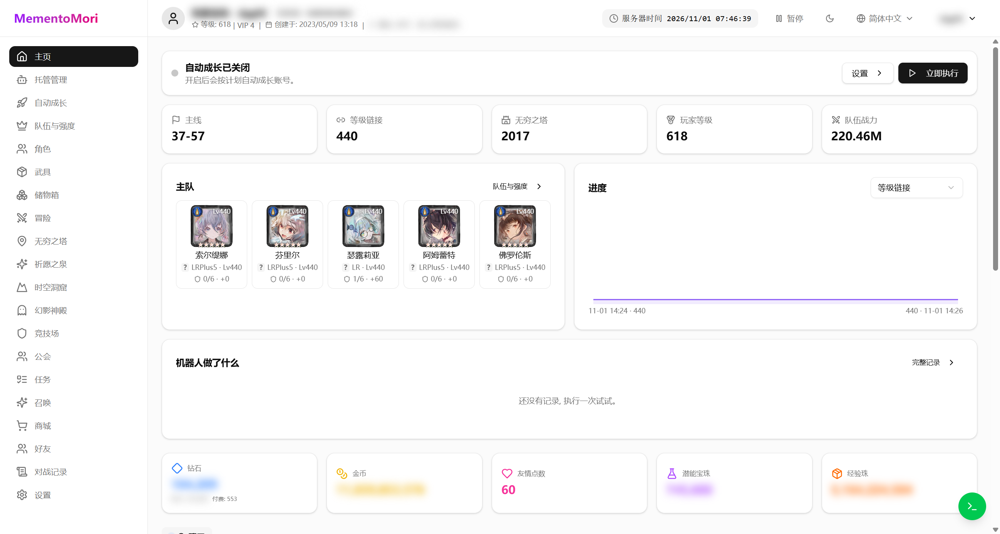

</td><td>

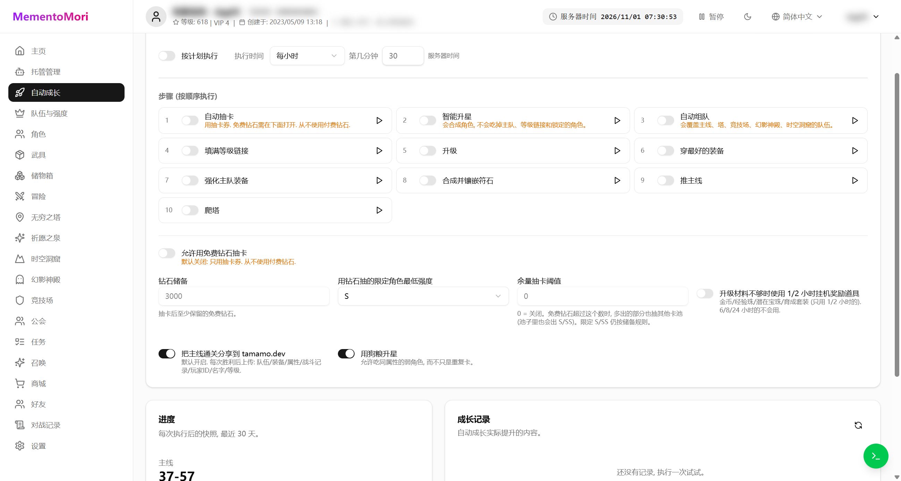

</td></tr>
<tr><td>

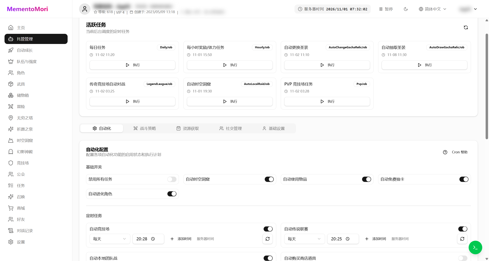

</td><td>

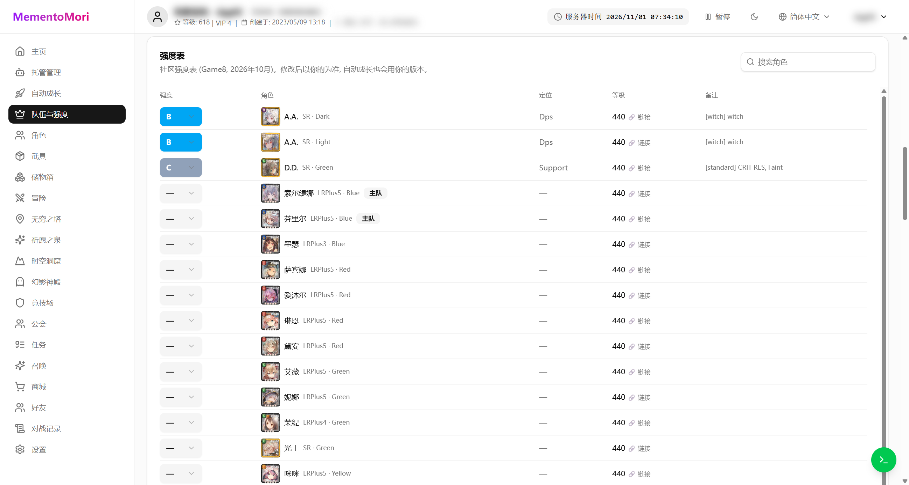

</td></tr>
<tr><td>

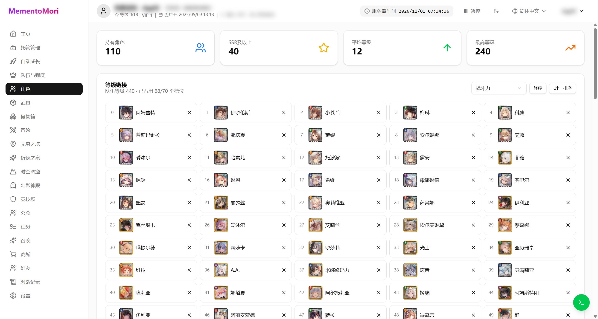

</td><td>

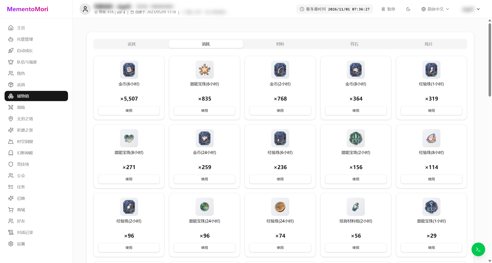

</td></tr>
<tr><td>

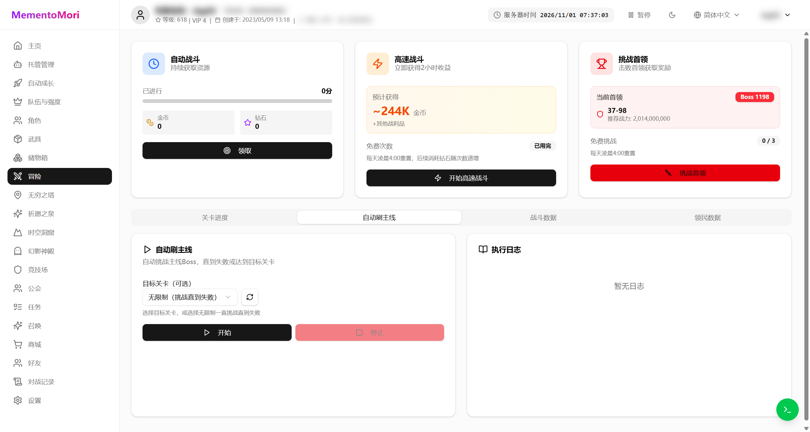

</td><td>

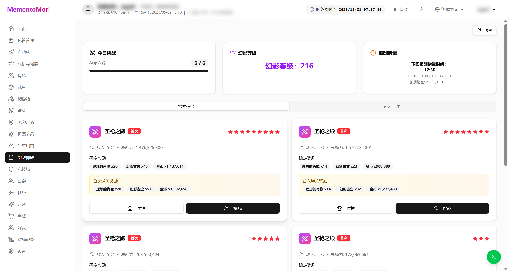

</td></tr>
<tr><td>

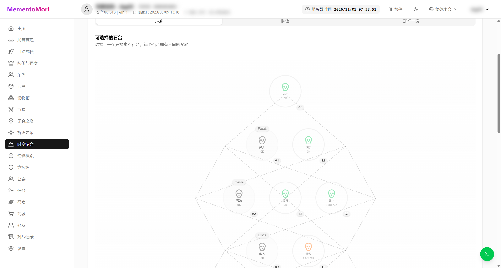

</td><td>

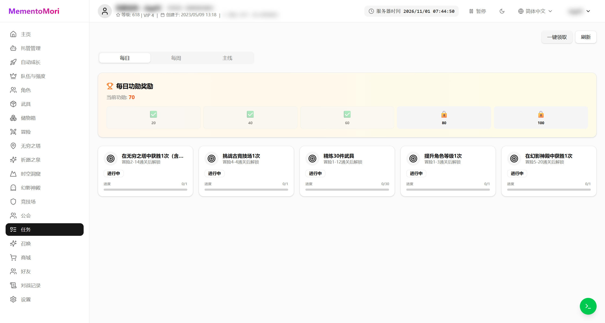

</td></tr>
<tr><td>

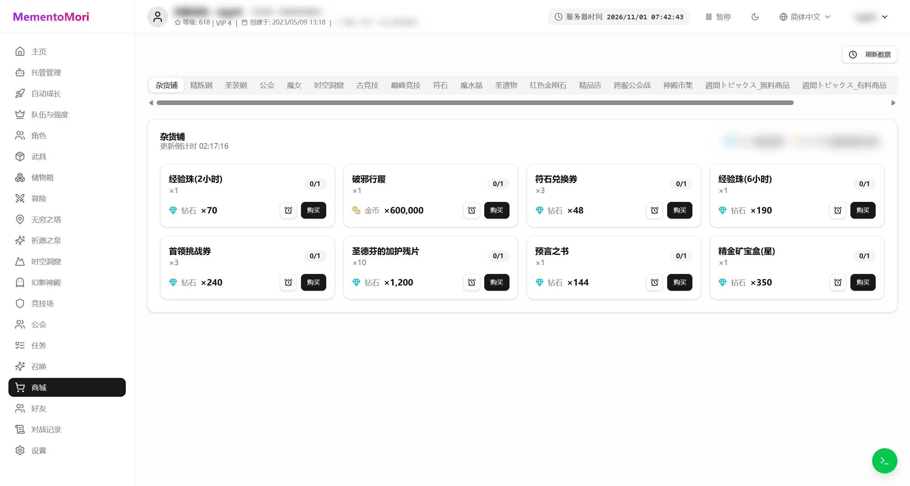

</td><td>

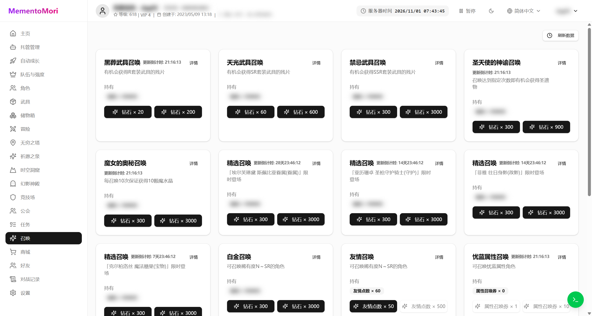

</td></tr>
</tbody>
</table>

## Features

### Accounts

- Multi-account: add with a ClientKey or with a transfer code + user ID; one account can have a character on several worlds
- Each account card shows online state, world and last login; press "Open" to enter
- The pause button stops all schedules and keeps the bot from logging in again, so it won't fight with your phone
- Account data lives in a local SQLite database; upgrading the program keeps it

### Home

- Today's progress: main quest, Level Link, Tower of Infinity, player level, team power, current team
- Autopilot switch and "Run now"
- Daily checklist: auto battle, high-speed battle, boss, arena, towers, guild, missions and more, each with a "Go" button
- Resources: diamonds (free / paid), gold, friend points, potential orbs, EXP orbs
- Shortcuts to login bonus, events, presents, notices, rankings

### Automatic tasks (Automation)

- **Basic switches**: disable all tasks, auto Temple of Illusions (Time-Space Cave), auto use items, auto free gacha, auto rank-up
- **Scheduled tasks**: arena, Legend League, local raid, auto buy shop items, switch relic wish, draw relic (10x), open guild raid — each with its own list of times
- **Other schedules**: daily job schedule and reward-claim schedule
- **Job actions**: pick exactly which actions run in the daily and hourly jobs (login bonus, VIP gift, gear reinforcement, sweeps, guild check-in, guild raid, bounty quests, dungeon, free gacha, …)

### Autopilot

Runs in order, and only the steps you switch on:

1. Pull gacha (tickets only by default)
2. Smart rank-up (never consumes your team, Level Link or locked characters)
3. Build the best team (overwrites the quest / tower / arena / temple / cave teams)
4. Fill the Level Link
5. Level up
6. Equip the best gear
7. Reinforce team gear
8. Combine and socket runes
9. Climb the main quest
10. Climb the towers

It can run hourly, every 2 / 4 / 6 / 12 hours or daily at a fixed time, and any single step can be run on its own. Options:

- **Diamond reserve**: never drop below this many free diamonds (3000 by default); spending free diamonds on gacha is off by default and paid diamonds are never used
- **Minimum pickup tier**: only spend diamonds on pickups rated at least S / SS
- **Rank up with fodder**: allow merging weak same-element characters, not only duplicates
- **Share to tamamo.dev**: on by default; after each main-quest win it uploads team, gear, stats, battle log and player info (can be turned off)
- **Progress / growth history**: a snapshot after every run for the last 30 days, so you can see level, quest and tower progress

### Team and tiers

- **Clears**: real clear records from tamamo.dev, showing what other players used on the same quest
- **Current / recommended team**: a team built from the tier list, applied in one click
- **Tier list**: community tiers (Game8); edit the ratings and autopilot uses your version
- **Gacha advice**: combines limited-character strength with your free diamond balance to suggest whether a banner is worth pulling

### Characters

- Character count, SSR and above, average level, highest level
- Level Link slots and current usage; characters can be removed from the link
- Filter by rarity, element and type, sort by power or level; open a character for stats, gear, skills and unique effects

### Gear and storage

- Gear page: equipment by slot, reinforcement level, runes; results of auto polish and refinement inheritance show up here
- Storage: gear / consumables / materials / runes / fragments; consumables can be used directly
- Gear reinforcement, auto refinement with inheritance to D-grade gear, divine gear inheritance and auto polishing run as part of the daily job

### Adventure and trials

- **Adventure**: claim auto-battle rewards, high-speed battle, challenge the boss, auto-clear the main quest (optional target quest; stops on defeat or when the target is reached), plus battle and population stats
- **Tower of Infinity**: sweep and auto-climb with an optional target floor; elemental towers have daily limits
- **Temple of Illusions**: one-click challenge, either joining existing rooms or hosting your own, with reward weighting
- **Time-Space Cave**: auto explore, auto-buy chosen items, prefer treasure nodes, auto-use recovery items
- **Fountain of Wishes**: claim all and dispatch automatically, optionally only quests that contain chosen rewards
- **Arena**: auto battle in the ancient arena and Legend League, picking the lowest-power opponent by default

### Shop and gacha

- **Shop**: every in-game shop, manual purchases, plus auto-buy rules (item, discount, currency)
- **Gacha**: banner list, remaining time, pity / ceiling progress, pull with diamonds or the matching tickets

### Other pages

- **Missions**: daily / weekly / main quest progress, claim all, daily merit rewards
- **Guild**: guild info, members, guild raid and guild war actions
- **Friends**: friends, pending, requested, search, blocked; send and receive friend points
- **Battle logs**: replays for main quest, towers and arena, with filters and JSON import / export
- **Settings**: per-account automation and battle strategy

## Usage

Download the file for your platform from [Releases](https://github.com/moonheart/mementomori-helper/releases):

| Platform | File |
| --- | --- |
| Windows x64 | `MementoMori-win-x64.zip` |
| Linux x64 | `MementoMori-linux-x64.tar.gz` |
| Linux arm64 | `MementoMori-linux-arm64.tar.gz` |
| Linux arm | `MementoMori-linux-arm.tar.gz` |
| macOS Intel | `MementoMori-osx-x64.tar.gz` |
| macOS Apple Silicon | `MementoMori-osx-arm64.tar.gz` |
| Android | `MementoMori-android.apk` |

No .NET or Node install is needed; unzip and run.

### Windows

Unzip `MementoMori-win-x64.zip` and double-click `start.bat`. The app listens on <http://localhost:5290> and opens the browser once it is ready.

Close that console window to stop it.

### Linux / macOS

```bash
tar -xzf MementoMori-linux-x64.tar.gz
cd MementoMori-linux-x64
./start.sh
```

It also listens on <http://localhost:5290>; the script tries to open a browser once the server responds (open it manually on a headless machine). Use systemd or `nohup` to keep it running.

### Docker

```bash
docker run -d --name mementomori \
  -p 127.0.0.1:5290:8080 \
  -v "$PWD/data:/data" \
  moonheartmoon/mementomori-webui
```

Or use the `docker-compose.yml` in [examples/docker-compose](examples/docker-compose). Listening only on `127.0.0.1` and putting a password-protected reverse proxy (nginx / Caddy) in front is recommended.

### Android

Download `MementoMori-android.apk` from the release page and install it (allow installing apps from unknown sources). The app runs the same helper and web UI on the phone itself, no PC or server needed. The first start downloads game data and can take a few minutes. While it runs it keeps a notification so Android doesn't stop the auto tasks in the background; tap "Stop" on the notification to quit.

### First start

The first run downloads the game master data, which takes a few minutes; progress is shown in the UI. Later starts are quick.

- Data lives in `Master/`, `BattleLogs/` and `mementomori.db` (SQLite) under the working directory
- When upgrading, replace the program files but keep `Master/`, `BattleLogs/`, `mementomori.db` and `appsettings.user.json`, and nothing is lost
- The default port is `5290`; change it with the `ASPNETCORE_URLS` environment variable or `appsettings.user.json` below

## Adding an account

The app opens on the accounts page. Press "Add Account":

- **Transfer code**: fill in a name, user ID and transfer code; the ClientKey is fetched automatically
- **ClientKey**: paste an existing ClientKey

After adding, press "Open" to enter the account; switch accounts from the accounts page at any time.

## Automatic tasks

Actions run at fixed server times, all configurable under Automation.

### Daily job (default 04:50)

- Daily login bonus, VIP daily gift, monthly boost
- Auto battle reward
- Friend points send / receive, presents
- Reinforce gear once (for the daily mission)
- Main quest sweep, Tower sweep, boss quick battle, boss high-speed battle
- Free high-speed battle
- Guild check-in, guild raid, guild tower
- Fountain of Wishes dispatch + collect
- Temple of Illusions (Time-Space Cave) run
- Daily / weekly mission rewards and achievement rewards
- Use fixed items, free gacha, character rank-up

### Reward claim (default 00:30, 04:30, 08:30, 12:30, 16:30, 20:30)

- Daily login bonus, auto battle reward
- Fountain of Wishes dispatch + collect
- Guild raid
- Friend points
- Mission rewards
- Guild war rewards
- Auto gacha, use fixed items

### Arena (default 20:00 / 20:10)

- Ancient arena 5 times
- Legend League 10 times

The opponent is the lowest-power player in the list by default.

### Other default times

| Task | Default time |
| --- | --- |
| Local raid (Temple of Illusions) | 12:31, 19:31 |
| Auto buy shop items | 09:09, 12:09, 15:09, 18:09 |
| Switch relic wish | Monday 04:40 |
| Draw relic (10x) | Sunday 06:00 |
| Open guild raid | every hour at minute 0 |

## Details

### Login bonus

Claims the daily login bonus, total-days bonus and limited-time bonuses.

### VIP daily gift / monthly boost

Claims the free VIP gift and the monthly reinforcement pack.

### Friend points

Sends and receives friend points automatically.

### Reinforce gear once

Completes the daily mission "enhance equipment once".

Strategy: equipped by a character, lowest level, and not at the reinforcement cap.

### Boss / Tower of Infinity

Uses the free daily attempts, preferring sweep and falling back to a challenge when sweep is locked.

### Ancient arena / Legend League

Fights 5 / 10 times, choosing the lowest-power opponent in the list.

### Free high-speed battle

Uses the free 2-hour high-speed battle attempts.

### Free gacha

Pulls with the configured items. Location: Settings → Resources → auto gacha items.

### Guild

- Claims the guild check-in reward
- Fights guild raids (sweep first)
- Opens the light guild raid automatically
- Deploys guild war defense: big strongholds first, then small ones; 5-character team first, then 3-character teams, then single characters; strongest characters first
- Claims guild war and cross-server guild war rewards

### Temple of Illusions

Fights automatically, either joining existing rooms or hosting your own (off by default: when no room is found, host one and run it solo).

#### Quest choice

With an event running: the quest with the highest event-item reward (first-clear + fixed).
Otherwise: the quest with the highest score from the configured reward weights.

#### Reward weights

Set them in Settings → Social → local raid (Temple of Illusions). The score is

$$Sort=weight\times\frac{N_{start\_{current}}^{lv\_{current}}}{N_{start\_{max}}^{lv\_{max}}}$$

For example, with

- Rune ticket: 5
- Potential orb: 3

and two quests:

- Quest A gives rune tickets x10, while a level 127 / 10-star quest gives x100, so $0.5=5\times\frac{10}{100}$
- Quest B gives potential orbs x30, while the same quest gives x2000, so $0.045=3\times\frac{30}{2000}$

Quest A is chosen.

### Fountain of Wishes

Claims rewards and dispatches characters automatically. Under Settings → Social → bounty quest you can tick the reward items you want; when none of the current quests contains them, the quest list is refreshed automatically (costs diamonds, with a configurable maximum, 0 = never refresh). On the page you can also refresh the normal quests manually (20 diamonds, with a confirmation) and quickly finish quests.

### Auto buy shop items

Configure the currency, the item and the minimum discount. Defaults:

- Any item for Tree of Life Dew at 20% off
- Any item for gold at 0% off

To add a rule: sidebar → Shop, press the clock button next to the currency, then set

- the item to buy (empty means any item)
- the minimum discount (0% off means no discount needed)
- the currency to spend (empty means any currency)
- at least one of item and currency must be set

### Use fixed items

Uses items whose type is "treasure chest" and whose reward type is fixed or random, such as chests and unidentified runes.

### Batch rank-up

Merges R into R+ and SR into SR+.

### Memories

Reads every unread character memory, which grants diamonds.

### Missions - claim all / medal rewards

Claims medals from completed missions, plus the daily and weekly medal rewards.

## FAQ

### How do I run multiple instances?

Copy the program folder and change the port in each `appsettings.user.json`, for example to 5700:

```json5
{
  "Kestrel": {
    "Endpoints": {
      "Http": {
        "Url": "http://localhost:5700"
      }
    }
  }
}
```

`appsettings.user.json` is a runtime override and is never replaced by an upgrade (precedence: `appsettings.json` < `appsettings.user.json` < environment variables < command line).

### How do I change the language?

Use the globe icon in the top right. Simplified Chinese is the default and the choice is stored in the browser; missing strings fall back to English.

The language of game text returned by the server is a setting (default zh), changeable in `appsettings.user.json`:

```json5
{
  "Localization": {
    "Culture": "zh"
  }
}
```

### Will upgrading lose my data?

No. Replace the program files and keep `Master/`, `BattleLogs/`, `mementomori.db` and `appsettings.user.json`.

### Where is the data stored?

- `mementomori.db`: accounts, settings, job history (SQLite)
- `Master/`: static game data downloaded from the game
- `BattleLogs/`: battle log JSON

With Docker these are mounted volumes, so removing the container keeps them.

### The first start seems stuck

The first run downloads tens of megabytes of game data, which takes longer on a slow connection; later starts only check for changes. Watch the console log for progress.

### Tasks don't run as expected

- Make sure "Disable all tasks" is off under Automation
- Make sure the individual action switch is on
- Press the pause button in the top right and press it again to resume; schedules do not run while paused
- Check the log for errors; the usual causes are the account being logged in elsewhere or a network timeout

## Development

```bash
# backend
dotnet build MementoMori.Api/MementoMori.Api.csproj

# frontend
cd web
pnpm install
pnpm dev        # dev server
pnpm build      # build to web/dist
pnpm locale:check   # locale coverage report
```

Build the release artifacts (builds the frontend and every platform's single-file binary):

```bash
./build-release.sh win-x64 linux-x64 linux-arm64 linux-arm osx-x64 osx-arm64
```
