[ [Zh](readme.md) | [En](readme.en.md) ]

# MementoMori 游戏助手

[](https://github.com/moonheart/mementomori-helper/actions/workflows/publish-dev.yml)
[](https://github.com/moonheart/mementomori-helper/releases)
[](https://github.com/moonheart/mementomori-helper/releases)
[](https://github.com/moonheart/mementomori-helper/releases)
[](https://hub.docker.com/r/moonheartmoon/mementomori-webui/)

多账号的 MementoMori 网页助手。在浏览器里管理多个账号、自动清日常、查看角色和装备、回放战斗记录，全部在一个程序里完成。

- **多账号**：用 ClientKey 或引继码添加账号，随时切换；点「暂停」可以停掉定时任务，你在手机上玩时不会被挤下线
- **自动任务**：每日 / 每小时的固定动作都能单独开关，执行时间可以改
- **自动成长**：按顺序抽卡 → 智能升星 → 组队 → 等级链接 → 装备 → 推主线 → 爬塔，只跑你打开的步骤，成长进度有曲线和记录
- **网页界面**：角色、武具、储物箱、商城、召唤、试炼、公会等 20 个页面，名称和图标直接来自游戏数据
- **多语言**：简体中文 / 繁體中文 / English / 日本語 / 한국어，默认简体中文，切换后立即生效
- **随处可跑**：Windows / Linux / macOS 单文件，Android APK，或者 Docker 部署在服务器上

[Telegram](https://t.me/+gTRe8AxKxIdkOTg9) [Discord](https://discord.gg/mJ3fWxrypx)

## **免责声明**

使用本辅助工具的用户（以下简称“用户”）请注意以下几点：

1. 本辅助工具仅供个人娱乐和教育目的使用。使用本工具可能违反特定游戏或应用的使用政策，请自行承担风险。

2. 开发者（以下简称“我们”）不对用户在游戏中使用本工具所产生的任何后果负任何法律或道德责任。用户应自行承担使用工具可能带来的风险。

3. 用户需明白，游戏或应用的开发者可能会采取措施来检测并阻止辅助工具的使用，这可能导致用户的账户被封禁或受到其他制裁。

4. 使用本辅助工具可能违反适用法律。用户需确保自己的使用遵守所有适用法律和法规。

5. 我们保留随时更改或停止本辅助工具的权利，无需提前通知。

通过下载、安装和使用本辅助工具，用户表明已详细阅读并理解此免责声明，并同意自行承担使用本工具所带来的一切风险。如不同意本声明的任何部分，请停止使用本辅助工具。

## 预览

截图来自简体中文界面，账号名、玩家 ID 等已打码。

<table>
<tbody>
<tr><td>

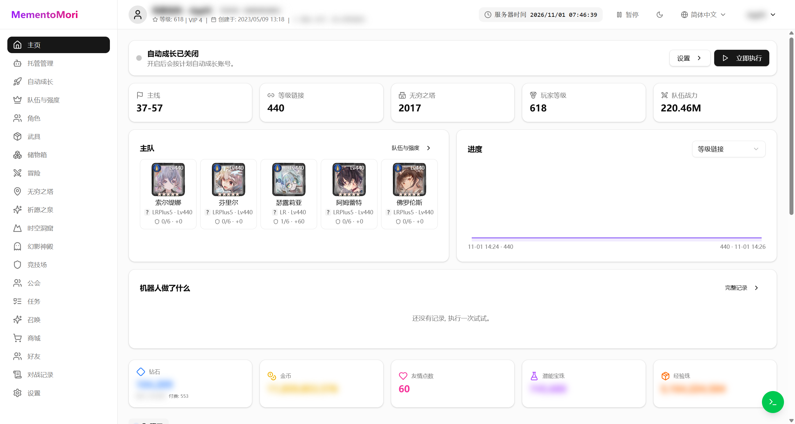

</td><td>

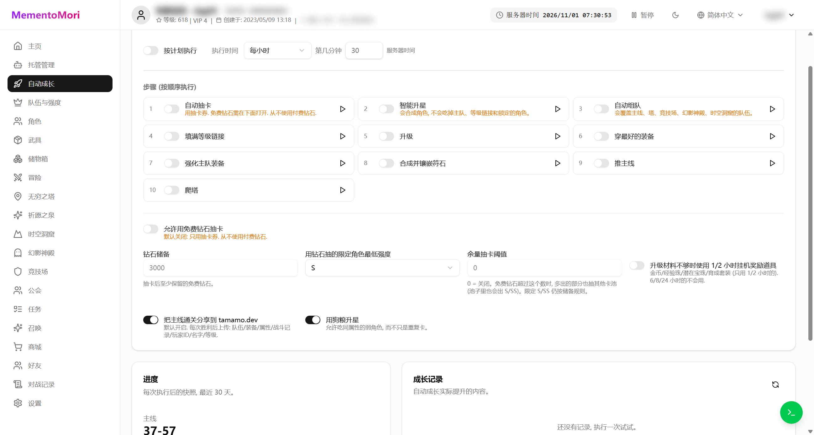

</td></tr>
<tr><td>

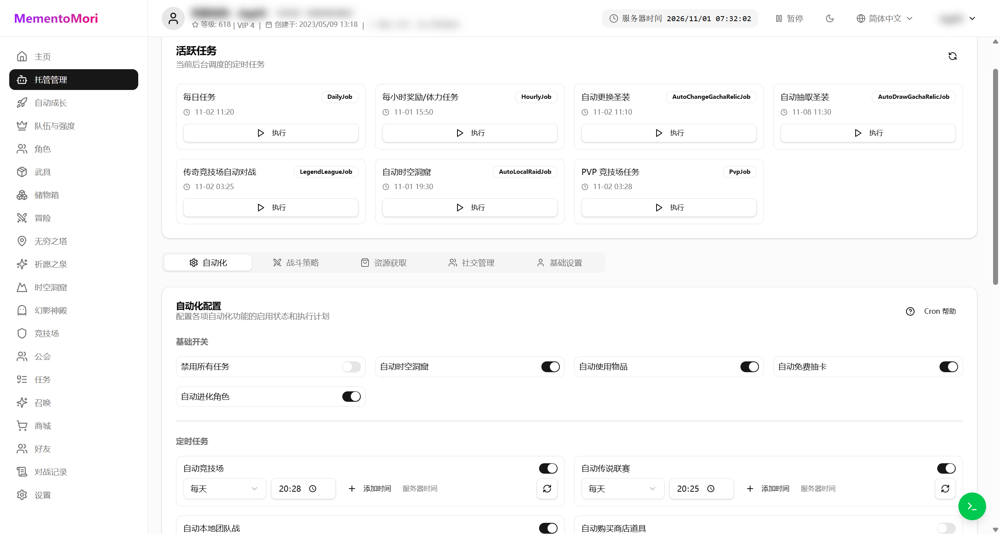

</td><td>

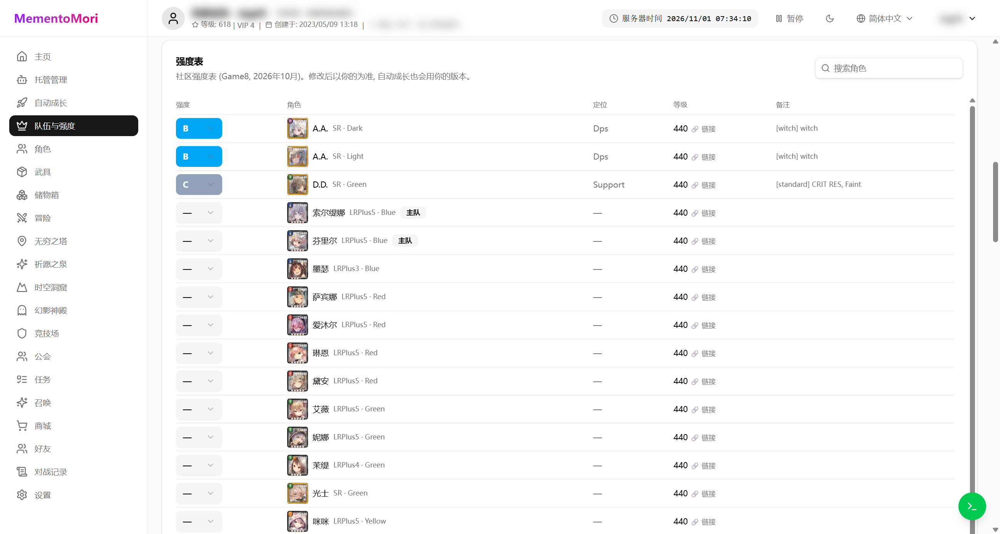

</td></tr>
<tr><td>

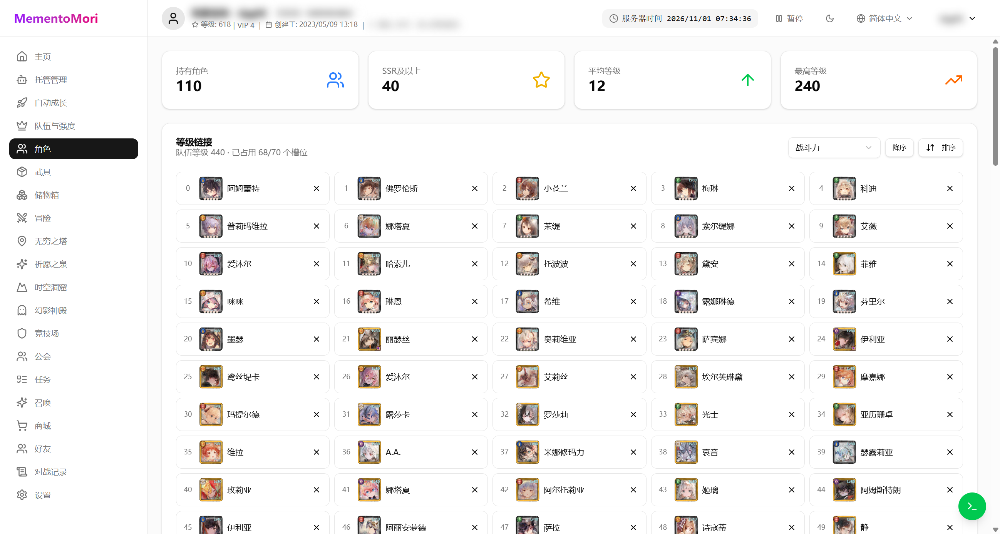

</td><td>

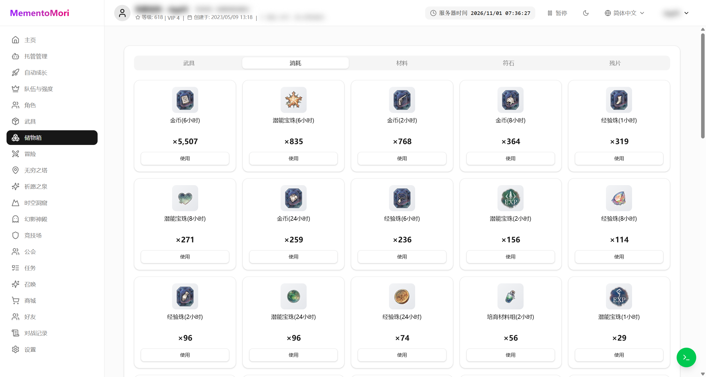

</td></tr>
<tr><td>

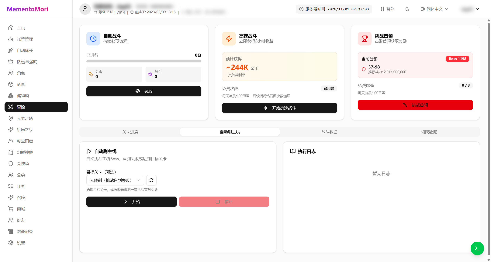

</td><td>

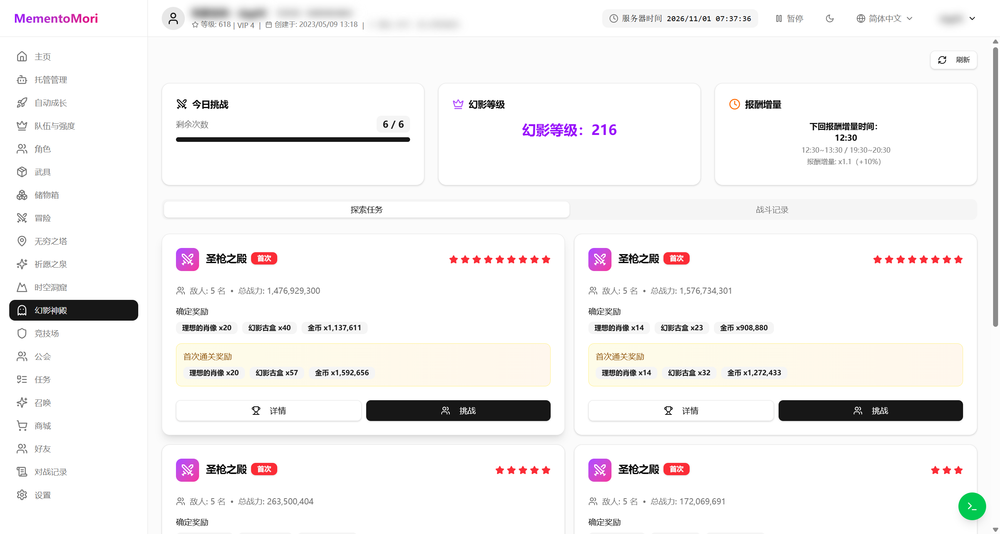

</td></tr>
<tr><td>

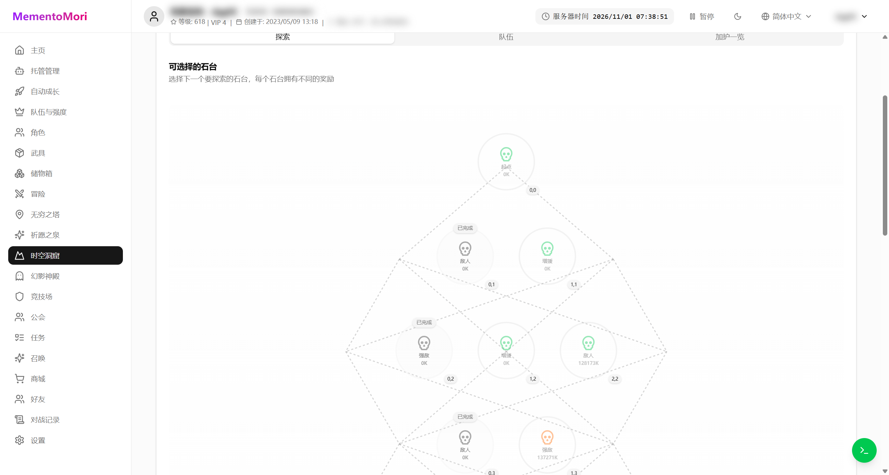

</td><td>

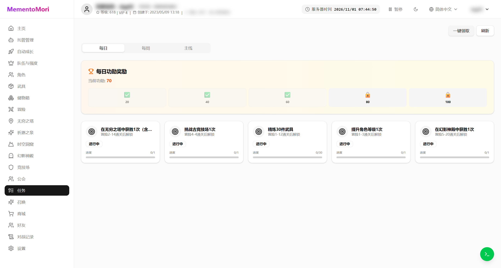

</td></tr>
<tr><td>

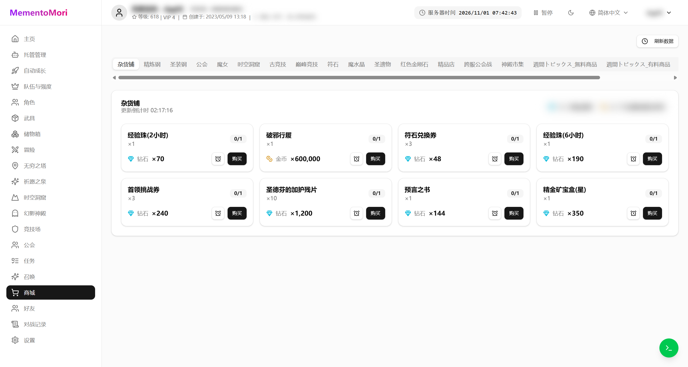

</td><td>

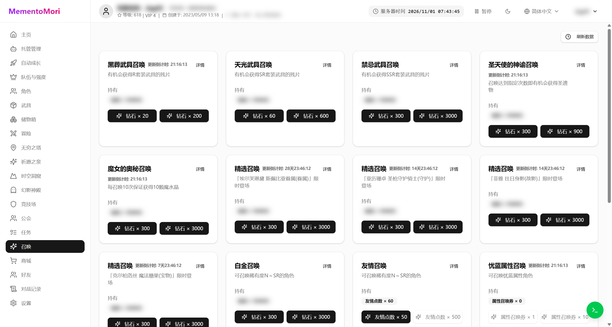

</td></tr>
</tbody>
</table>

## 功能

### 账号

- 多账号：ClientKey 或「引继码 + 用户 ID」两种方式添加，一个账号可以在多个世界各有一个角色
- 账号卡片上可以直接看到在线状态、世界、上次登录时间，点「打开」进入
- 「暂停」会停掉所有定时任务并且不再自动重新登录，避免和手机端互相踢下线
- 账号信息保存在本地 SQLite 数据库里，升级程序不会丢

### 主页

- 今日进度：主线、等级链接、无穷之塔、玩家等级、队伍战力、主队阵容
- 自动成长开关和「立即执行」
- 每日清单：自动战斗、高速战斗、挑战首领、竞技场、爬塔、公会、任务等完成情况，附「前往」按钮
- 资源一览：钻石（免费 / 付费）、金币、友情点数、潜能宝珠、经验珠
- 常用入口：签到奖励、活动、礼物、公告、排行榜等

### 自动任务（托管管理）

- **基础开关**：禁用所有任务、自动时空洞窟、自动使用物品、自动免费抽卡、自动进化角色
- **定时任务**：自动竞技场、自动传说联赛、自动幻影神殿（本地团队战）、自动购买商店道具、切换圣遗物愿望、抽取圣遗物（10 连）、自动开启公会讨伐战，每一项都可以配多个执行时间
- **其他计划**：每日任务计划、奖励领取计划
- **任务动作**：每日任务和每小时任务里具体执行哪些动作（登录奖励、VIP 礼包、装备强化、扫荡、公会签到、公会 Raid、赏金任务、地下城、免费抽卡……）都可以单独关掉

### 自动成长

按顺序执行，只跑你打开的步骤：

1. 自动抽卡（只用抽卡券，默认不花钻石）
2. 智能升星（不会吃掉主队、等级链接和锁定的角色）
3. 自动组队（会覆盖主线 / 塔 / 竞技场 / 幻影神殿 / 时空洞窟的队伍）
4. 填满等级链接
5. 升级
6. 穿最好的装备
7. 强化主队装备
8. 合成并镶嵌符石
9. 推主线
10. 爬塔

可以按小时 / 每 2、4、6、12 小时或每天固定时间执行，也可以只跑某一步。下面还有：

- **钻石储备**：抽卡后至少保留多少免费钻石（默认 3000），「允许用免费钻石抽卡」默认关闭，从不使用付费钻石
- **抽卡强度门槛**：只对强度达到 S / SS 的限定角色用钻石
- **用狗粮升星**：允许吃同属性的弱角色，而不只是重复卡
- **分享到 tamamo.dev**：默认开启，每次主线胜利后上传队伍、装备、属性、战斗记录和玩家信息（可关闭）
- **进度 / 成长记录**：每次执行后的快照，最近 30 天，可以看等级、地图推进和塔层数的变化

### 队伍与强度

- **通关队伍**：全服真实通关记录（来自 tamamo.dev），可以看到别人在同一个关卡用了什么队伍
- **当前 / 推荐队伍**：根据强度表推荐一套队伍，可以一键套用
- **强度表**：社区强度表（Game8），可以在页面上改成自己的评级，自动成长会按你改过的版本组队
- **卡池建议**：结合限定角色强度和免费钻石余额，提示「值不值得抽」

### 角色

- 角色总数、SSR 及以上数量、平均等级、最高等级
- 等级链接槽位和当前占用情况，可以移出链接
- 角色列表支持按稀有度、属性、类型筛选，按战斗力 / 等级排序，点开可以看属性、装备、技能和专属效果

### 武具与储物箱

- 武具页：按部位查看装备、强化等级、宝石镶嵌，自动打磨 / 精炼继承的结果会反映在这里
- 储物箱：武具 / 消耗 / 材料 / 符石 / 残片五个分类，消耗品可以直接「使用」
- 装备强化、自动精炼魔装并继承到 D 级装备、神装继承、自动打磨都在每日任务里完成

### 冒险与试炼

- **冒险**：领取自动战斗奖励、高速战斗、挑战首领、自动刷主线（可设目标关卡，打到失败或到达目标为止），另有战斗数据和领民数据
- **无穷之塔**：扫荡和自动爬塔，可设目标层数；属性塔每天有次数限制
- **幻影神殿**：一键挑战，可选「蹭车」或自己开房，按报酬权重选择任务
- **时空洞窟**：自动探索、自动买指定商品、优先选宝箱节点、自动使用恢复道具
- **祈愿之泉**：一键领取、一键派遣，可以只派包含指定报酬的任务
- **竞技场**：古竞技场和巅峰竞技场自动战斗，对手默认选战力最低的

### 商店与召唤

- **商城**：和游戏内一致的各个商店，可以手动购买；也可以设置自动购买（物品、折扣、消耗品）
- **召唤**：卡池列表、剩余时间、保底 / 天井进度，可以用钻石或对应的券抽卡

### 其他页面

- **任务**：每日 / 每周 / 主线任务进度，一键领取，每日功勋奖励
- **公会**：公会信息、成员、公会讨伐战和公会战相关操作
- **好友**：好友列表、待同意、申请中、搜索、屏蔽，一键赠送 / 领取友情点
- **对战记录**：主线、塔、竞技场的战斗回放，支持筛选和导入 / 导出 JSON
- **设置**：按账号保存的自动化配置和战斗策略

## 使用

到 [Releases](https://github.com/moonheart/mementomori-helper/releases) 下载对应平台的文件：

| 平台 | 文件 |
| --- | --- |
| Windows x64 | `MementoMori-win-x64.zip` |
| Linux x64 | `MementoMori-linux-x64.tar.gz` |
| Linux arm64 | `MementoMori-linux-arm64.tar.gz` |
| Linux arm | `MementoMori-linux-arm.tar.gz` |
| macOS Intel | `MementoMori-osx-x64.tar.gz` |
| macOS Apple Silicon | `MementoMori-osx-arm64.tar.gz` |
| Android | `MementoMori-android.apk` |

不需要安装 .NET 或 Node，解压就能跑。

### Windows

解压 `MementoMori-win-x64.zip`，双击 `start.bat`。程序会启动在 <http://localhost:5290>，就绪后自动打开浏览器。

关闭那个命令行窗口就停止运行。

### Linux / macOS

```bash
tar -xzf MementoMori-linux-x64.tar.gz
cd MementoMori-linux-x64
./start.sh
```

同样监听 <http://localhost:5290>，脚本会在服务就绪后尝试打开浏览器（无桌面环境时手动访问即可）。想后台常驻可以配 systemd 或 `nohup`。

### Docker

```bash
docker run -d --name mementomori \
  -p 127.0.0.1:5290:8080 \
  -v "$PWD/data:/data" \
  moonheartmoon/mementomori-webui
```

也可以直接用 [examples/docker-compose](examples/docker-compose) 里的 `docker-compose.yml`。建议只监听 `127.0.0.1`，前面放一个带密码的反向代理（nginx / Caddy）。

### Android

下载 `MementoMori-android.apk` 安装（需要允许安装未知来源应用）。App 在手机上直接运行同样的助手和网页界面，不需要电脑或服务器。第一次启动会下载游戏数据，可能要几分钟。运行时会有一个常驻通知，这样 Android 不会在后台停掉自动任务；点通知上的「Stop」退出。

### 第一次启动

第一次运行会下载游戏数据（Master），需要几分钟，界面上会显示进度。之后启动就很快了。

- 数据目录：当前工作目录下的 `Master/`、`BattleLogs/`，账号和配置在 `mementomori.db`（SQLite）
- 换新版本时只替换程序文件，保留 `Master/`、`BattleLogs/` 和 `mementomori.db`，账号和配置就不会丢
- 端口默认 `5290`，可以用环境变量 `ASPNETCORE_URLS` 或下面的 `appsettings.user.json` 修改

## 添加账号

打开页面后默认进入账号页，点「添加账号」：

- **引继码**：填账号名称、用户 ID、引继码，系统会自动获取 ClientKey
- **ClientKey**：已经有 ClientKey 的话可以直接填

添加后点「打开」进入该账号，之后随时可以在账号页切换。

## 自动任务

程序会在服务器时间的固定时刻执行任务，时间都可以在「托管管理」里改。

### 每日任务（默认 04:50）

- 收取每日登录奖励、每日 VIP 礼物、月度加成
- 收取自动战斗奖励
- 发送 / 收取友情点，领取礼物箱
- 强化一次装备（用于完成每日任务）
- 主线扫荡、无穷之塔扫荡、Boss 快速战斗、Boss 高速战斗
- 免费高速战斗
- 公会签到、公会讨伐战、公会塔
- 祈愿之泉派遣 + 收取
- 时空洞窟自动执行
- 收取每日 / 每周任务奖励、成就奖励
- 使用固定道具、免费抽卡、角色进化

### 奖励定时收取（默认 00:30、04:30、08:30、12:30、16:30、20:30）

- 收取每日登录奖励、自动战斗奖励
- 祈愿之泉派遣 + 收取
- 公会讨伐战
- 友情点收取
- 任务奖励收取
- 公会战奖励收取
- 自动抽卡、使用固定物品

### 竞技场（默认 20:00 / 20:10）

- 古竞技场 5 次
- 传说联赛 10 次

对手默认选列表中战斗力最低的。

### 其他默认时间

| 任务 | 默认时间 |
| --- | --- |
| 幻影神殿 | 12:31、19:31 |
| 自动购买商店道具 | 09:09、12:09、15:09、18:09 |
| 切换圣遗物愿望 | 每周一 04:40 |
| 抽取圣遗物（10 连） | 每周日 06:00 |
| 自动开启公会讨伐战 | 每小时第 0 分 |

## 功能说明

### 签到奖励

自动领取每日签到奖励、累计签到天数奖励、限时签到奖励。

### VIP 每日福利 / 每月强化组合包

自动领取 VIP 每日免费礼物和每月强化组合包。

### 友情点数

自动赠送和领取友情点数。

### 强化一次装备

用于完成每日任务「進行武具強化1次」。

装备选择策略：有角色装备的、等级最低的、且未达到强化上限的装备。

### 挑战首领 / 无穷之塔

自动使用每日免费次数。优先扫荡，扫荡没解锁时改为挑战。

### 古竞技场 / 巅峰竞技场

自动进行 5 次 / 10 次战斗，对手选列表中战斗力最低的玩家。

### 免费高速战斗

自动使用免费的 2 小时高速战斗次数。

### 免费召唤

用配置的道具抽卡。位置：设置 → 资源获取 → 自动抽卡消耗物品。

### 公会

- 自动领取公会签到奖励
- 自动进行公会讨伐战（优先扫荡）
- 自动开启光士公会讨伐战
- 公会战部署防御：从大据点到小据点依次部署，第一次 5 人一队，之后 3 人一队，剩下 1 人一队；角色按战斗力从高到低选
- 自动领取公会战和跨服公会战奖励

### 幻影神殿

自动进行幻影神殿的战斗。可以随机加入已有房间，也可以自己开房单刷（默认关闭，开启后等不到房间就自己开）。

#### 任务选择策略

有活动时：选择活动道具报酬数量（首次奖励 + 固定奖励）最高的任务。
无活动时：按选项中配置的报酬权重选择。

#### 报酬权重

进入 设置 → 社交管理 → 本地团队战（幻影神殿）可以设置报酬权重，计算方法如下：

$$Sort=weight\times\frac{N_{start\_{current}}^{lv\_{current}}}{N_{start\_{max}}^{lv\_{max}}}$$

假如设置是这样的：

- 符石兑换券：5
- 潜能宝珠：3

有两个任务：

- 任务 A 报酬为符石兑换券 x10，127 级 10 星的任务报酬为符石兑换券 x100，计算可得 $0.5=5\times\frac{10}{100}$
- 任务 B 为潜能宝珠 x30，127 级 10 星的任务报酬为潜能宝珠 x2000，计算可得 $0.045=3\times\frac{30}{2000}$

最终会选择任务 A 进行战斗。

### 祈愿之泉

自动领取奖励、自动派遣角色。在 设置 → 社交管理 → 悬赏任务 里可以勾选「自动派遣目标项目」；当前任务里没有这些项目时会自动刷新（消耗钻石，可以设置最大次数，0 = 不刷新）。页面上也可以手动刷新常规任务（20 钻石，会先确认）和快速完成任务。

### 自动购买商城物品

可以设置消耗的道具、购买的物品、最低折扣。默认：

- 用任意物品购买生命树之露 20%OFF
- 用金币购买任意物品 0%OFF

添加规则：左侧栏 - 商城，点消耗道具旁边的闹钟按钮，在弹出的对话框里设置

- 要购买的物品，清空表示购买所有物品
- 商品打折幅度，0%OFF 表示不需要打折
- 消耗的物品，清空表示可以消耗任意物品
- 购买物品和消耗物品至少要指定一个

### 使用固定物品

自动使用类型为「宝箱」且奖励类型为「固定」或「随机」的道具，例如宝箱、未鉴定符石。

### 批次进化

自动把 R 卡合成为 R+，SR 卡合成为 SR+。

### 回忆

自动阅读所有未阅读的角色回忆，可以获得钻石。

### 任务 - 全部领取 / 奖章奖励

领取已完成任务的奖章，以及每日任务和每周任务的奖章奖励。

## 常见问题

### 如何多开？

复制一份程序目录，在各自的 `appsettings.user.json` 里改端口，例如改成 5700：

```json5
{
  "Kestrel": {
    "Endpoints": {
      "Http": {
        "Url": "http://localhost:5700"
      }
    }
  }
}
```

`appsettings.user.json` 是运行时覆盖，升级程序时不会被覆盖（优先级：`appsettings.json` < `appsettings.user.json` < 环境变量 < 命令行参数）。

### 怎么换语言？

右上角的地球图标里选。默认简体中文，选择会记在浏览器里；界面文案缺失时会回退到英文。

服务端返回的游戏文本语言由配置决定（默认 zh），需要的话可以在 `appsettings.user.json` 里改：

```json5
{
  "Localization": {
    "Culture": "zh"
  }
}
```

### 升级会丢数据吗？

不会。替换程序文件即可，保留 `Master/`、`BattleLogs/`、`mementomori.db` 和 `appsettings.user.json`。

### 数据存在哪？

- `mementomori.db`：账号、配置、任务记录（SQLite）
- `Master/`：从游戏下载的静态数据
- `BattleLogs/`：战斗记录 JSON

Docker 部署时这些都是挂载出来的目录，删容器不会丢。

### 第一次启动很久没反应？

第一次要下载几十 MB 的游戏数据，网速慢时会久一些。之后启动只做增量检查。可以看日志窗口确认进度。

### 任务没有按预期执行？

- 确认「托管管理」里「禁用所有任务」没有打开
- 确认对应动作的开关是开的
- 点右上角的「暂停」后再点一次可以恢复，被暂停时任务不会执行
- 看「查看日志」里的错误信息，常见原因是账号在别处登录、网络超时

## 开发

```bash
# 后端
dotnet build MementoMori.Api/MementoMori.Api.csproj

# 前端
cd web
pnpm install
pnpm dev        # 开发服务器
pnpm build      # 构建到 web/dist
pnpm locale:check   # 检查各语言文案覆盖率
```

打包发布版本（会构建前端并生成各平台单文件）：

```bash
./build-release.sh win-x64 linux-x64 linux-arm64 linux-arm osx-x64 osx-arm64
```
